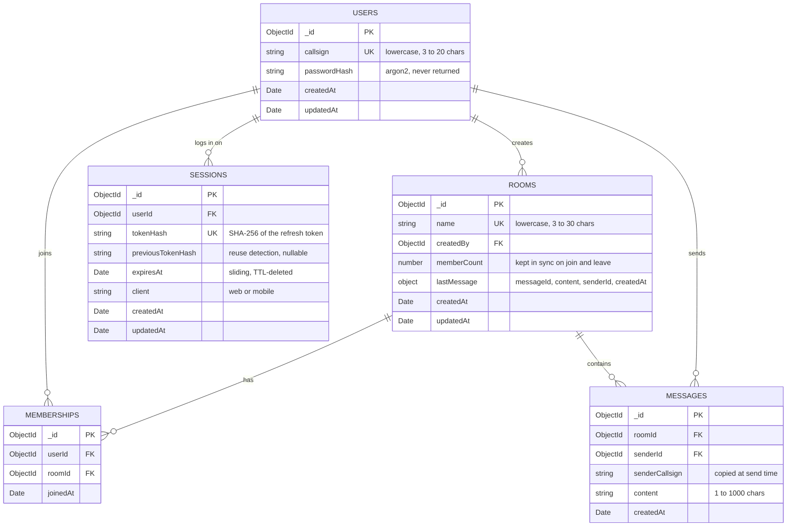

# Callsign

A real-time chat app with a WW2 field-radio feel. Chatrooms are called **nets** and users are identified by a **callsign**.

- **API:** NestJS + MongoDB, REST for nets and history, Socket.IO for live messages
- **Web:** Vite + React, sharing its UI with mobile through react-native-web
- **Mobile:** Expo (React Native)

## Prerequisites

- **Node.js 24.9 or newer** (`.nvmrc` pins 24; run `nvm use` if you use nvm)
- **pnpm**, enabled through Corepack (the exact version is pinned in `package.json`):
  ```bash
  corepack enable
  ```
- **Docker** for the local MongoDB (e.g. [OrbStack](https://orbstack.dev) or Docker Desktop)
- **Xcode** with an iOS Simulator and/or **Android Studio** with an emulator, to run the mobile app. Or the **Expo Go** app on a phone.

## Setup

```bash
pnpm install
```

```bash
cp apps/api/.env.example apps/api/.env
```

## Running the apps

Run each app in its own terminal, from the repo root.

### Database

```bash
pnpm db:up
```

Starts MongoDB 8 in Docker on `localhost:27017` and waits until it is healthy. Data is kept in a Docker volume. `pnpm db:down` stops it and keeps the data.

#### Viewing the data

With the database running, open a shell on the `callsign` database (the container ships `mongosh`, nothing to install):

```bash
docker compose exec mongo mongosh callsign
```

| What                          | Command                                         |
| ----------------------------- | ----------------------------------------------- |
| list the collections          | `show collections`                              |
| stations (without the hashes) | `db.users.find({}, { passwordHash: 0 })`        |
| nets                          | `db.rooms.find()`                               |
| who is in which net           | `db.memberships.find()`                         |
| the 5 newest messages         | `db.messages.find().sort({ _id: -1 }).limit(5)` |
| indexes of a collection       | `db.messages.getIndexes()`                      |

`exit` leaves the shell. For a GUI, install [MongoDB Compass](https://www.mongodb.com/products/tools/compass) (`brew install --cask mongodb-compass`) and connect to `mongodb://localhost:27017`. It also shows each collection's indexes and query plans (Explain).

### API

```bash
pnpm --filter @callsign/api dev
```

Runs on http://localhost:3000 and restarts on file changes. All routes are under `/api`, e.g. http://localhost:3000/api.

### Web

```bash
pnpm --filter @callsign/web dev
```

Runs on http://localhost:5173. Requests to `/api` and `/socket.io` are proxied to the API, so the web app and API share one origin in development.

### Mobile

```bash
pnpm --filter @callsign/mobile start
```

Starts the Expo dev server. Then press:

- **`i`** to open the iOS Simulator (Expo Go is installed automatically the first time)
- **`a`** to open an Android emulator
- or scan the QR code with Expo Go on your phone (phone and computer on the same Wi-Fi)

`pnpm --filter @callsign/mobile ios` opens the iOS Simulator directly.

### API and web together

```bash
pnpm dev
```

Starts the API, the web app and a watcher that rebuilds `@callsign/types` on change, all through Turbo in one terminal. Mobile runs separately because Expo's menu needs its own terminal.

### Shared types

`@callsign/types` is built to `packages/types/dist`. `pnpm dev`, `pnpm test` and `pnpm typecheck` build it automatically. When you start apps one by one and change the types, rebuild them:

```bash
pnpm --filter @callsign/types build
```

## Checks

| Command                                | What it does                        |
| -------------------------------------- | ----------------------------------- |
| `pnpm lint`                            | ESLint over the whole repo          |
| `pnpm format` / `pnpm format:check`    | Prettier write / check              |
| `pnpm typecheck`                       | TypeScript in every app and package |
| `pnpm test`                            | Unit tests in every app and package |
| `pnpm --filter @callsign/api test:e2e` | API end-to-end tests                |
| `pnpm build`                           | Production builds (types, API, web) |

A pre-commit hook lints and formats staged files and runs the typecheck. Commit messages must follow [Conventional Commits](https://www.conventionalcommits.org), e.g. `feat(api): add auth module`. CI runs all checks above on every push and pull request.

## Project structure

```
apps/
  api/       NestJS + MongoDB
  web/       Vite + React
  mobile/    Expo (React Native)
packages/
  types/     Zod schemas + TypeScript types (the API contract)
  config/    shared ESLint, Prettier and TypeScript configs
docs/
  api-contract.md   REST endpoints and Socket.IO events
  design/           screen mockups
```

## Data model

MongoDB collections used by the API:



- **Memberships** link users and nets, instead of a member array on each room.
- **`memberCount`** and **`lastMessage`** are copies kept on the room, so the nets list needs no extra queries.
- **`senderCallsign`** is copied onto each message, so history pages need no user lookups (callsigns never change).
- Online status is not stored in the database.

| Collection  | Index                              | Used for                                          |
| ----------- | ---------------------------------- | ------------------------------------------------- |
| users       | `{ callsign: 1 }` unique           | login, register                                   |
| sessions    | `{ tokenHash: 1 }` unique          | refresh, logout                                   |
| sessions    | `{ userId: 1 }`                    | a user's devices                                  |
| sessions    | `{ expiresAt: 1 }` TTL             | MongoDB deletes expired sessions                  |
| sessions    | `{ previousTokenHash: 1 }` partial | reuse detection                                   |
| rooms       | `{ name: 1 }` unique               | creating a net (duplicate check)                  |
| memberships | `{ userId: 1, roomId: 1 }` unique  | "my nets" (covered query), prevents joining twice |
| memberships | `{ roomId: 1 }`                    | members of a net, socket room sync                |
| messages    | `{ roomId: 1, _id: -1 }`           | paginated history (cursor on `_id`)               |
